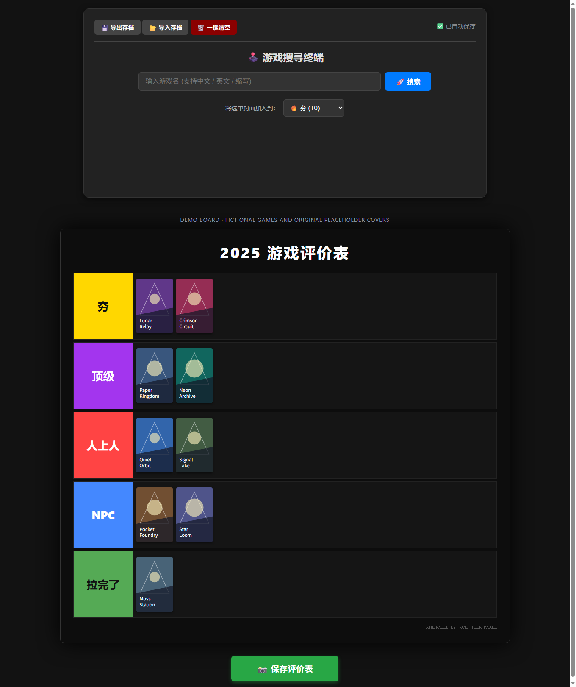

# GameTierList

I wanted a quick way to rank the games I played over the year and share one image with friends. GameTierList is a small local web app for building that board without collecting cover art by hand.



*Demo board captured from the running app. The titles and covers in the screenshot are fictional.*

## Build a list

1. Enter a game title. The app searches the Steam Store and Bangumi in parallel. SteamGridDB adds alternate art when configured.
2. Choose a tier and click a cover to add it. The app prevents duplicate covers and lets you remove individual cards.
3. Export the board as PNG, or export a JSON backup to restore it later. The board autosaves in your browser's local storage.

The tier labels and app interface are in Chinese. The five tiers are unchanged from my personal setup.

## Run locally

Requires Python 3.9 or newer.

```bash
python -m venv .venv
# Activate .venv, then:
python -m pip install -r requirements.txt
python app.py
```

Open [http://127.0.0.1:5000](http://127.0.0.1:5000). For optional settings, copy `.env.example` to `.env`. The server binds to the loopback interface.

| Setting | Purpose |
| --- | --- |
| `SGDB_API_KEY` | Optional SteamGridDB key. Leave blank to use Steam and Bangumi only. |
| `FLASK_DEBUG` | Enable Flask debugging for local development. Defaults to `False`. |
| `PORT` | Local port. Defaults to `5000`. |

The stack is Flask and Requests on the server, and vanilla HTML, CSS and JavaScript in the browser. [html2canvas](https://github.com/niklasvh/html2canvas) renders the PNG export.

## Third-party sources

[Steam Store](https://store.steampowered.com/), [Bangumi](https://github.com/bangumi/api), and [SteamGridDB](https://www.steamgriddb.com/api/v2) provide search data or cover images at runtime. Search queries go to the enabled services. Artwork belongs to its respective rights holders. This repository ships no provider artwork, credentials, or personal board data.
